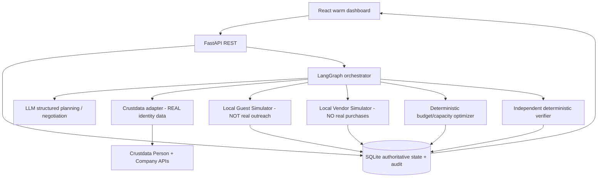
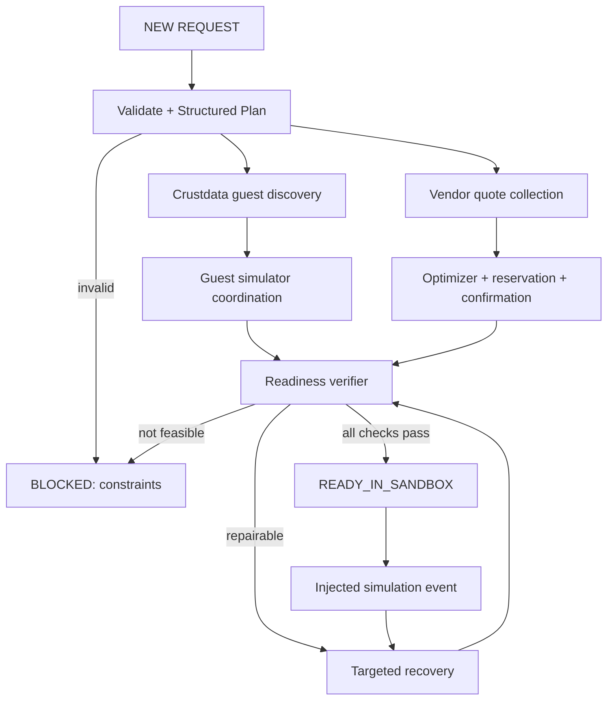

# ARCHITECTURE — EventOps Autopilot v1

## 0. Product boundary and positioning
**Service being automated:** professional event coordinator / small event management agency for workshops, club orientations, hackathons, community sessions. Client pays for coordinated *arrangements* (guest sourcing and confirmation, procurement, fallback and readiness), not for a chatbot-generated plan.

**Input:** audience, location, theme, event date/time/duration, venue capacity, desired guests, hard budget, expected turnout, constraints and priorities.

**Completed outcome in hackathon:** sandbox-confirmed guests, sandbox-confirmed vendor orders, contingency and verifiable readiness record, with *real Crustdata identity evidence* behind guest relevance. The system does not actually secure external guests, purchase real goods or run an event.

**Business hypothesis:** better coordination speed and fewer disruption-induced failures at lower event-management overhead. Do not claim demonstrated economic savings until compared against baseline and actual vendor costs.

## 1. Source requirements vs design decisions
| Source: ContextCon PS PDF | Design response |
|---|---|
| Must use Crustdata canonical people/company identity graph | Real Crustdata Person Search / Enrich for speakers; optional Company Identify/Enrich for collaborators; persist provenance |
| Agents may not interact with external real people during event | All guests/vendors represented by **local deterministic simulated accounts**; no live Gmail/SMS/WhatsApp/LinkedIn |
| Five hours and unfamiliar request end-to-end | Single orchestrator, stable schemas, seeded simulator capable of theme variations |
| Robustness, edge cases | Cancellation event, hold expiry, price increase, unavailable guest, capacity surge, timeout, idempotency |
| Two-minute demo | Request → real search evidence → confirmations → injected vendor cancellation → automatic recovery → verified ledger |

**Engineering proposals (not explicit PS requirements):** LangGraph, FastAPI, SQLite, React, use of synthetic vendors and guest replies, simple optimization, six functional modules.

## 2. Functional blocks and ownership

### B1: Request understanding & event strategy
- Parse event brief to `EventBrief` via structured LLM output; validate numeric constraints with Pydantic.
- Distinguish `hard` constraints (budget, venue cap, times, required guest count, dietary needs) from `soft` goals (experience score, keynote prestige, style).
- Define procurement needs: catering quantity, AV equipment, reserve buffer; compute session slots.
- If an impossible request appears, return `BLOCKED` with explicit violated constraints. Never silently relax hard constraints.

### B2: Guest + collaborator intelligence (Crustdata)
- Build topic/role search query, call real Crustdata Person Search, optionally Person Enrich / Company Identify.
- Persist `source_kind=CRUSTDATA`, timestamp, canonical person/company IDs, matched attributes and source links/references when returned.
- Rank on *relevance* (role expertise, topic match, seniority, industry), **not availability, contact permission or honorarium**; these are unknown until simulated negotiation.
- Guest simulator maps selected candidate to a **synthetic participant behavior**. Explicitly label the simulated layer. Never imply a real person agreed.
- Source-aware fallback: if search empty or quota exhausted, mark inability to perform real discovery; cached previously retrieved identity evidence is not equivalent to a fresh search.

### B3: Guest communication & agreement
- Guest provider interface: `send_invitation`, `read_reply`, `send_message`, `reserve_slot`, `confirm_booking`, `cancel_booking`.
- During event: local seeded inbox with conditional guest responses (`accept`, `decline`, `ask_fee`, `reschedule`, `cancel_later`).
- Persistent conversation thread, maximum 3 negotiation rounds, fee/time policy, calendar overlap check, verified `ACCEPTED` → `BOOKED` transition.
- No actual email/calendar invite to real guest. Later production adapter may use Gmail/Calendar with authorization and consent, **outside competition**.

### B4: Procurement, budget and logistics
- Simulated suppliers expose quote, capacity, menu, lead time, delivery, cancellation fee, reservation expiry, reliability.
- `optimizer` selects feasible combination within hard budget; prefer lower all-in cost, then reliability and flexibility. A hold is not a confirmed booking.
- Transactional accounting fields: `budget_total`, `committed`, `paid` (always synthetic), `active_hold_liability`, `nonrefundable_fees`, `available`.
- Booking operation: validate → atomically create `order` with idempotency key → read back → mark confirmed. On cancellation, record fees and restore availability only if supplier terms permit.
- Venue capacity is an immutable hard ceiling; if turnout exceeds it, return waitlist/cap or use an explicitly available alternative venue.

### B5: Promotion & participant engagement (P1)
- Produce event summary, poster-ready copy, 20–30 sec reel storyboard, channel plan, registration cap/incentives.
- Agent may inspect supplied audience characteristics; do **not** claim live trend research unless a real authorized source is queried.
- No real social posting under hackathon scope. Data model stores `campaign_asset` and content/evidence, not published URLs.

### B6: Monitoring, recovery, verification
- Every action emits an append-only `AuditEvent`: actor, tool, input hash, result state, source IDs, time, simulated/live label.
- Recovery triggers: `GUEST_DECLINED`, `GUEST_CANCELLED`, `VENDOR_CANCELLED`, `HOLD_EXPIRED`, `PRICE_CHANGED`, `ATTENDANCE_UPDATED`, `TOOL_TIMEOUT`.
- Event-driven re-entry into recovery graph; do not create a background infinite loop. In demo, a simulation endpoint emits a trigger.
- Independent **deterministic** verifier reads SQLite state and checks: confirmed guest count, time overlaps, valid vendor bookings/capacity, delivery deadlines, headcount, budget constraints, and no duplicate active orders.
- Status `READY_IN_SANDBOX` only if **every mandatory check passes**; else `NEEDS_RECOVERY` or `BLOCKED` with reasons.

## 3. Component + trust boundary diagram


**Hard trust boundary:** only the Crustdata adapter accesses external information APIs. No outbound human messaging tools are enabled in hackathon mode. The LLM cannot directly mutate the database; actions go through validated tool handlers.

## 4. State graph

`Guest` and `procurement` can be implemented sequentially first for easier integration. Real parallel graph execution is optional.

## 5. State and data model
Authoritative SQLite tables: `events`, `guest_candidates`, `guest_threads`, `guest_bookings`, `vendors`, `offers`, `holds`, `orders`, `registrations`, `issues`, `audit_events`, `promotion_assets`.
- One `event_id` joins every record.
- `guest_candidate`: Crustdata identity reference and evidence, ranking score, simulated invitation status.
- `guest_thread`: message array / message records, synthetic `from`, `to`, `text`, message IDs, `SIMULATED`.
- `guest_booking`: slot + requirements + honorarium + `SIMULATED` confirmation status.
- `offer/hold/order`: separate entities and statuses; `hold` includes expiry. A `confirmed` order must reference an accepted offer.
- `audit_event`: append-only proof of what was observed and executed.

**Agent scratch state:** event_id, outstanding_issue_ids, next_action, run_attempt, latest tool results, model reasoning summary. Never use LangGraph checkpoint as the only source of booking truth.

## 6. LLM vs deterministic responsibilities
| Task | Owner |
|---|---|
| Extract messy event brief | LLM with Pydantic schema validation |
| Find candidate search keywords | LLM with bounded parameters |
| Relevance of verified guest identity | LLM rank + cite actual fields |
| Simulated negotiation message composition | LLM subject to policy |
| Decide recovery path | Agent, bounded attempts |
| Budget arithmetic, reservation expiry | Python deterministic |
| Calendar overlap, delivery cutoff, venue capacity | Python deterministic |
| Idempotent order placement and audit | DB transaction |
| Readiness status | Independent verifier |

## 7. Operational reliability rules
1. Every mutating tool requires `{event_id, idempotency_key}`; DB unique constraint on key.
2. Never retry `book` blindly after a timeout: first query by idempotency key.
3. Hold expiry is compared using timezone-aware timestamps; use event-local timezone for slots.
4. Retry recoverable network errors 2 times with short backoff; capped agent loops (e.g., max 3 recovery attempts per issue).
5. When evidence conflicts, include source provenance and mark unresolved; do not invent current title or availability.
6. Vendor cancellation must invalidate its previously counted capacity; keep actual cancellation liabilities in committed budget.
7. Suppress double guest reservations in overlapping slots.
8. Return precise `BLOCKED` reason rather than hallucinated confirmations.
9. Explicit `SIMULATED` badge on every guest invite/order confirmation.
10. Never expose Crustdata keys to browser or logs.

## 8. Hard limits / non-goals
- No real emails, calls, DMs, WhatsApp, LinkedIn outreach or real person interaction during the event.
- No real financial commitments, payments or vendor orders.
- No real proof that a Crustdata professional wants to speak or is available.
- No full video/reel rendering, social publishing, attendee phone location or production cloud autoscaling.
- No fabricated real-time booking confirmation.

## 9. Environment configuration
```
CRUSTDATA_API_KEY=...         # backend only
CRUSTDATA_API_BASE=https://api.crustdata.com
CRUSTDATA_API_VERSION=2025-11-01
LLM_API_KEY=...               # provider chosen at build time
SIMULATION_MODE=true          # MUST stay true during hackathon
DATABASE_URL=sqlite:///./eventops.db
CORS_ORIGINS=http://localhost:5173
```
Use official Crustdata endpoint paths and request schemas as provided in its documentation/walkthrough; **do not invent endpoint paths**. Required Crustdata headers per hackathon PS: `authorization: Bearer <key>`, `x-api-version: 2025-11-01`.

## 10. Completion criteria
The run is successful only if one unfamiliar event request yields: `>= required_guest_count` simulated booked guests grounded in Crustdata candidates; confirmed sandbox catering/equipment meeting requirements; committed + contingent liabilities within budget; all capacity/deadline checks passed; an injected cancellation recovered; and audit log plus final verification report generated.
