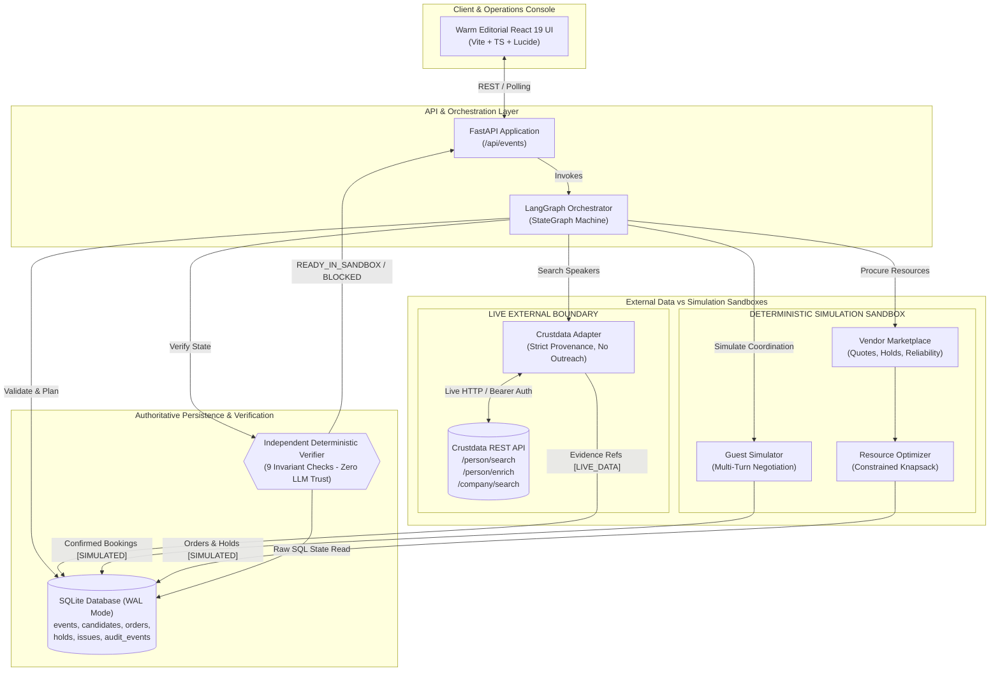

# 🎪 EventOps Autopilot
### *Autonomous Campus & Enterprise Event Operations Console*

[](https://www.python.org/)
[](https://fastapi.tiangolo.com/)
[](https://langchain-ai.github.io/langgraph/)
[](https://crustdata.com/)
[](https://react.dev/)
[](https://www.sqlite.org/)
[](#running-the-test-suite)

> **ContextCon IIT Bombay Hackathon Build**  
> An autonomous agent system that converts messy natural-language event briefs into a **verified, executable sandbox event arrangement**. Integrates the **REAL Crustdata identity graph** for expert speaker intelligence alongside deterministic simulated guest negotiation, multi-resource vendor procurement, and autonomous disruption recovery.

---

## ⚡ Elevator Pitch

Organizing campus summits, hackathons, and corporate orientations usually demands dozens of chaotic hours: scouring LinkedIn for domain experts, back-and-forth email negotiations, juggling caterers and AV rentals within hard budgets, and scrambling when a key vendor cancels 48 hours prior.

**EventOps Autopilot** compresses this entire operational lifecycle into seconds:
1. **Live Discovery**: Discovers verified industry experts via real-time **Crustdata canonical people search and enrichment** (`/person/search`, `/person/enrich`), capturing tamper-proof data provenance.
2. **Deterministic Negotiation**: Coordinates invitations and calendar slots through a multi-turn guest simulator respecting honorarium ceilings and non-overlapping schedules.
3. **Constrained Procurement**: Optimizes multi-vendor resource allocation (catering, AV, seating) against hard budget and attendance limits with idempotent holds and bookings.
4. **Independent Deterministic Verification**: Never trusts LLM assertions; independently evaluates raw SQLite records across 9 strict invariants, emitting `READY_IN_SANDBOX` or `BLOCKED`.
5. **Hero Recovery**: Autonomously intercepts injected disruptions (vendor cancellations, guest dropouts, attendance surges), invalidates failed orders, activates backup holds, and re-verifies the entire operational ledger without human panic.

> [!IMPORTANT]
> **Competition Safety Boundary**: In strict adherence to hackathon safety rules, the system maintains a zero-outreach policy toward real individuals. Crustdata queries fetch live professional identity and evidence, but all invitations, bookings, and vendor transactions are executed within isolated, deterministic **local simulation sandboxes**. UI components clearly badge every artifact as either `LIVE_DATA` or `SIMULATED`.

---

## 🔄 End-to-End Workflow

EventOps Autopilot executes a state machine orchestrated with LangGraph, transitioning through six rigorous stages:

```
┌─────────────────┐      ┌─────────────────────────┐      ┌─────────────────────────┐
│ 1. INTAKE &     │ ───► │ 2. LIVE CRUSTDATA       │ ───► │ 3. SIMULATED GUEST      │
│ VALIDATION      │      │ IDENTITY DISCOVERY      │      │ COORDINATION            │
│ Hard budgets &  │      │ Real Person/Enrich APIs │      │ Multi-round negotiation │
│ venue capacity  │      │ Evidence provenance     │      │ Non-overlapping slots   │
└─────────────────┘      └─────────────────────────┘      └─────────────────────────┘
                                                                       │
                                                                       ▼
┌─────────────────┐      ┌─────────────────────────┐      ┌─────────────────────────┐
│ 6. AUTONOMOUS   │ ◄─── │ 5. DETERMINISTIC        │ ◄─── │ 4. MULTI-RESOURCE       │
│ DISRUPTION      │      │ VERIFIER                │      │ PROCUREMENT             │
│ RECOVERY        │      │ Zero LLM trust          │      │ Optimal vendor combos   │
│ Invalidate & sub│      │ Checks 9 invariants     │      │ Idempotent holds/orders │
└─────────────────┘      └─────────────────────────┘      └─────────────────────────┘
```

### Step 1: Constraint Intake & Validation
- Parses free-form natural language event requests into strongly-typed `EventBrief` contracts via Pydantic v2.
- Enforces strict hard constraints: `expected_attendance <= venue_capacity`, positive budgets, valid timestamps, timezone offsets (`Asia/Kolkata`), and mandatory resource requirements (`catering`, `av`, `seating`).
- If an impossible brief is provided, immediately flags `CAPACITY_EXCEEDED` or `SCHEDULE_CONFLICT` and halts in `BLOCKED` status without wasting downstream API calls.

### Step 2: Live Crustdata Identity Discovery
- Queries the live **Crustdata REST API** (`/person/search`, `/person/enrich`, `/company/search`) to discover domain leaders matching the event topic (e.g., Generative AI, Robotics, Distributed Systems).
- Sanitizes incoming profiles: intentionally strips private contact info (emails, personal phone numbers) to guarantee competition compliance.
- Normalizes records into `GuestCandidate` models with immutable `EvidenceRef` objects, linking source claims (title, company, skills, headline) to canonical `crustdata_person_id`s with `LIVE_DATA` tags.
- Ranks candidates via deterministic keyword overlap and seniority weighting.

### Step 3: Simulated Guest Coordination & Calendar Confirmation
- Translates top-ranked candidates to simulated negotiation actors within `SimulatedGuestChannel`.
- Formulates calendar proposals: slices the event timeline into non-overlapping session slots (e.g., 45-minute talks with 15-minute buffers).
- Executes simulated multi-turn counter-offers (acceptances, fee negotiations up to honorarium caps, schedule adjustments) within a 3-round limit.
- Persists confirmed speaker agreements as `CONFIRMED_SIMULATED` bookings in SQLite.

### Step 4: Multi-Resource Vendor Procurement & Constrained Optimization
- Collects quotes from the simulated vendor marketplace across mandatory services:
  - **Catering**: Per-head costing, dietary compliance (`vegetarian_option`, `vegan`, `halal`), delivery lead times.
  - **AV Equipment**: Stage microphones, projectors, sound reinforcement.
  - **Seating & Logistics**: Chair sets, stage setup, podiums.
- The `ResourceOptimizer` solves a multi-objective constraint problem: minimizes cost, maximizes supplier reliability scores, and retains backup holds.
- Issues idempotent orders (`CONFIRMED_SIMULATED`) backed by cryptographic idempotency keys (`idemp_...`) to prevent double-charging or duplicate bookings during network retries.

### Step 5: Independent Deterministic Verification
- An autonomous verifier (`EventVerifier`) inspects raw database state—**completely isolated from LLM output or self-reported claims**.
- Evaluates 9 mandatory operational invariants:
  1. `capacity_valid`: Venue capacity strictly accommodates expected attendance.
  2. `schedule_valid`: Confirmed guest slots have zero time overlaps.
  3. `mandatory_resources_covered`: Every required service has an active order.
  4. `quantities_sufficient`: Catering & seating orders meet or exceed attendance.
  5. `deliveries_punctual`: Vendor delivery deadlines precede the event start time.
  6. `budget_intact`: Total committed cost + hold liabilities + guest honoraria $\le$ total budget.
  7. `critical_issues_resolved`: No unresolved critical operational alerts.
  8. `guests_confirmed`: Number of confirmed speakers matches brief requirement.
  9. `evidence_grounded`: Every booked speaker possesses valid Crustdata provenance.
- Emits final status: `READY_IN_SANDBOX` (all checks pass) or `BLOCKED`.

### Step 6: Autonomous Disruption Recovery (The Hero Moment)
- Injected disruptions test the agent's real-time operational resilience:
  - **Vendor Cancellation**: Marks failed order as `CANCELLED`, calculates non-refundable fees, instantly promotes a pre-reserved backup hold into a confirmed order (or queries marketplace for next-best quote), and re-verifies the ledger.
  - **Guest Cancellation**: Removes dropped guest, queries stored backup candidates discovered via Crustdata, runs accelerated simulated outreach, locks the slot, and restores readiness.
  - **Attendance Surge**: Recalculates catering and seating quantities, validates venue headroom, updates order tiers, and rebalances budget reserves.
- All recoveries are transactional and idempotent, appending audit events to the ledger.

---

## 💎 Impact & Real-World Value

| Metric / Dimension | Traditional Manual Operations | EventOps Autopilot |
|---|---|---|
| **Turnaround Time** | 2–5 days of manual emails, calls & quotes | **< 30 seconds** end-to-end sandbox execution |
| **Speaker Sourcing** | Keyword guessing, manual LinkedIn browsing | **Instant Crustdata Identity Graph** discovery with canonical IDs |
| **Data Integrity** | Prone to hallucinations & unverified claims | **100% Strict Provenance** (`LIVE_DATA` vs `SIMULATED` distinction) |
| **Disruption Recovery** | Scrambled panic, event-day cancellations | **Automated Zero-Downtime Backup Holds** & instant re-verification |
| **Verification** | Spreadsheets with broken formulas & overlaps | **Deterministic 9-Invariant Verifier** reading raw SQLite state |
| **Financial Safety** | Accidental budget overruns & duplicate orders | **Cryptographic Idempotency Keys** & multi-tier ledger tracking |

---

## 🏛️ System Architecture



---

## 🛠️ Tech Stack & Key Approaches

### 1. Backend & Architecture
- **Python 3.14 / 3.11+**: Modern async runtime with `asyncio`, type annotations, and structured concurrency.
- **FastAPI**: Non-blocking asynchronous REST framework with auto-generated OpenAPI documentation.
- **LangGraph & LangChain**: Directed acyclic state graph orchestrator governing stage transitions, conditional recovery branching, and execution control.
- **Pydantic v2**: Strict data contracts, datetime parsing, and input boundary validation.
- **SQLite with WAL Mode**: Authoritative single source of truth; write-ahead logging enables concurrent reads and atomic multi-table transactions.

### 2. Live Data & Identity Intelligence
- **Real Crustdata API**:
  - `/person/search`: Discovers domain leaders based on skills, titles, and locations.
  - `/person/enrich`: Gathers deep career history, current employment, and canonical IDs.
  - `/company/search`: Corporate and sponsor identification.
- **Evidence Provenance Engine**: Converts raw upstream payloads into `EvidenceRef` claims (`claim`, `support`, `source_id`, `collected_at`).
- **Safety Stripping Filter**: Purges all phone numbers and email addresses to guarantee non-outreach compliance during hackathon execution.

### 3. Simulation & Procurement Engines
- **Simulated Guest Channel**: State-machine simulated speaker actor supporting conditional counter-offers, honorarium negotiations, and schedule constraints.
- **Simulated Vendor Marketplace**: Seeded catalog of regional caterers, AV rental providers, and seating suppliers with explicit delivery lead times and cancellation fee schedules.
- **Constrained Resource Optimizer**: Linear multi-criteria optimization prioritizing lowest total cost, adequate capacity buffers, and highest reliability ratings.

### 4. Warm Editorial Frontend
- **Design Philosophy**: Designed like a trusted physical editorial desk rather than generic neon cyberpunk AI dashboards.
- **Warm Editorial Color Palette**:
  - Background: Warm Cream Ivory (`#F7F4ED`)
  - Surface: Card Paper White (`#FFFEFA`)
  - Primary CTA: Terracotta Red (`#B85C38`) / Hover (`#8B432B`)
  - Status Indicators: Forest Green (`#356B51`) for `READY`, Amber (`#C28B36`) for `HELD`, Crimson (`#B54945`) for `BLOCKED`.
- **Badge Differentiation**: High-contrast, unambiguous pills distinguishing `LIVE_DATA` Crustdata records from `SIMULATED` operational bookings.
- **Real-Time Audit Timeline**: Interactive step-by-step activity feed tracing every validation, search, booking, disruption, and verifier decision.

---

## 🛡️ Unique Architectural Principles

### 1. Independent Deterministic Verifier (Zero LLM Trust)
Language models are probabilistic and prone to claiming success even when constraints are violated. EventOps Autopilot decouples verification entirely:
- The verifier **never** inspects the LLM's scratchpad or prompts.
- It queries the raw SQLite database directly.
- It tests every invariant deterministically (summing integer prices, computing non-overlapping interval algebra, checking delivery timestamps).

### 2. Strict Safety & Provenance Boundary
Every piece of data flowing through the system carries a mandatory `mode` attribute:
- `LIVE_DATA`: Sourced directly from authenticated Crustdata identity endpoints.
- `SIMULATED`: Synthetic guest replies, vendor quotes, and mock financial transactions.
This prevents operators or hackathon evaluators from ever confusing mock bookings with real-world commitments.

### 3. Idempotent Sandboxed Procurement
Every reservation, hold, and replacement order is tagged with an idempotent hash:
$$\text{key} = \text{SHA256}(\text{event\_id} \parallel \text{offer\_id} \parallel \text{service})$$
Even if the orchestrator re-runs nodes due to transient failures or network latency, duplicate bookings are mathematically impossible.

---

## 📡 API Reference & Endpoints

| Method | Endpoint | Description |
|---|---|---|
| `POST` | `/api/events` | Submit an event brief; starts asynchronous LangGraph background execution. |
| `GET` | `/api/events` | List all historical and active events with high-level readiness status. |
| `GET` | `/api/events/{id}` | Fetch complete event state: brief, plan, guests, vendor orders, and readiness checks. |
| `GET` | `/api/events/{id}/timeline` | Retrieve chronological append-only audit trail and execution timeline. |
| `POST` | `/api/events/{id}/simulate` | Inject a disruption (`VENDOR_CANCELLED`, `GUEST_CANCELLED`, `ATTENDANCE_CHANGED`). |
| `POST` | `/api/events/{id}/verify` | Trigger an immediate deterministic verification pass across raw database state. |
| `GET` | `/api/events/{id}/promotion` | (P1) Generate draft promotional copy, reel storyboard, and social assets. |

### Sample Brief Payload (`POST /api/events`)
```json
{
  "title": "IIT Bombay AI Builders Summit 2026",
  "topic": "Autonomous AI Agents and Applied LLMs",
  "city": "Mumbai",
  "timezone": "Asia/Kolkata",
  "starts_at": "2026-11-15T10:00:00+05:30",
  "ends_at": "2026-11-15T17:00:00+05:30",
  "budget_inr": 45000,
  "expected_attendance": 120,
  "venue_capacity": 150,
  "guest_count": 2,
  "mandatory_resources": ["catering", "av", "seating"],
  "dietary_requirements": ["vegetarian_option"]
}
```

### Sample Disruption Payload (`POST /api/events/{id}/simulate`)
```json
{
  "event_type": "VENDOR_CANCELLED",
  "target_id": "ord_cater_mumbai_delight_120",
  "reason": "Kitchen equipment malfunction"
}
```

---

## 🚀 Quickstart & Setup Guide

### Prerequisites
- **Python 3.11+** (Developed & tested on Python 3.14)
- **Node.js 18+** & `npm`
- **Crustdata API Token** (Optional for mock testing; required for live speaker queries)

### 1. Repository Setup & Virtual Environment
```bash
# Clone the repository
git clone https://github.com/atharva-3000/Insti-Event-Ops-automate.git
cd Insti-Event-Ops-automate

# Create and activate Python virtual environment
python -m venv venv

# Windows (PowerShell):
.\venv\Scripts\Activate.ps1
# Linux / macOS:
source venv/bin/activate

# Install backend dependencies
pip install -r requirements.txt
```

### 2. Environment Configuration
Create or update the `.env` file in the root directory:
```ini
# Live Crustdata API key
CRUSTDATA_API_KEY=your_crustdata_api_token_here

# Crustdata API Base & Version
CRUSTDATA_API_BASE=https://api.crustdata.com
CRUSTDATA_API_VERSION=2025-11-01

# Authoritative SQLite Database path
DATABASE_URL=sqlite:///./eventops.db

# Frontend CORS origins
CORS_ORIGINS=http://localhost:5173,http://127.0.0.1:5173

# Simulation safety flag
SIMULATION_MODE=true
```

### 3. Launching the Backend
```bash
uvicorn backend.main:app --host 127.0.0.1 --port 8000 --reload
```
The interactive API documentation is available at `http://127.0.0.1:8000/docs`.

### 4. Launching the Frontend
In a separate terminal:
```bash
cd frontend
npm install
npm run dev
```
Open your browser at `http://localhost:5173`.

---

## 🧪 Running the Test Suite

The test suite validates every module using `pytest` and `pytest-asyncio`:

```bash
# Run all tests
pytest -v

# Run targeted test suites
pytest backend/tests/test_integration.py -v       # End-to-end integration and recovery
pytest backend/tests/test_vendor_recovery.py -v   # Injected vendor cancellation & backups
pytest backend/tests/test_crustdata.py -v         # Live Crustdata adapter & error handling
pytest backend/tests/test_optimizer.py -v         # Multi-vendor constrained optimizer
pytest backend/tests/test_guest.py -v             # Speaker ranking & simulated negotiations
pytest backend/tests/test_api.py -v               # FastAPI REST endpoint contracts
```

### What the Tests Verify
- ✅ **Happy Path Planning**: Ingests brief, discovers speakers via Crustdata, books vendors within budget, and achieves `READY_IN_SANDBOX`.
- ✅ **Candidate Decline Fallback**: Gracefully shifts to the next ranked candidate when the top candidate declines.
- ✅ **Slot Renegotiation**: Adapts when a candidate requests an alternative slot or honorarium counter-offer.
- ✅ **Vendor Disruption Recovery**: Injects a vendor cancellation, verifies that the backup hold is activated, checks fee accounting, and re-confirms readiness.
- ✅ **Attendance Surge**: Simulates a 25% attendance spike, expands catering & seating quantities, checks venue capacity headroom, and re-verifies.
- ✅ **Idempotent Retry**: Re-running an event execution causes zero duplicate orders or double-bookings.
- ✅ **Constraint Enforcement**: Rejects over-capacity venues and impossible budgets with explicit `BLOCKED` states.

---

## 📂 Project Directory Structure

```
Insti-Event-Ops-automate/
├── backend/
│   ├── main.py                     # FastAPI routes, middleware, and background execution
│   ├── db.py                       # SQLite EventStore (atomic schema, audit logging, issues)
│   ├── schemas.py                  # Pydantic v2 data models, enums, and API contracts
│   ├── agent/
│   │   └── graph.py                # LangGraph StateGraph orchestration & recovery router
│   ├── services/
│   │   ├── crustdata.py            # Live Crustdata async client, evidence builder, sanitizer
│   │   ├── guest.py                # Speaker relevance ranking and simulated coordination
│   │   ├── vendor.py               # Vendor procurement, hold management, and recovery logic
│   │   ├── optimizer.py            # Constrained multi-vendor resource optimization
│   │   ├── procurement_store.py    # Dedicated procurement ledger (orders, holds, ledger)
│   │   ├── verification.py         # Independent deterministic 9-invariant verifier
│   │   └── promotion.py            # (P1) Draft campaign, storyboard, and social generator
│   ├── simulator/
│   │   ├── guest_simulator.py      # Seeded guest responses & multi-turn negotiation
│   │   ├── vendor_simulator.py     # Seeded supplier marketplace, quotes, and lead times
│   │   ├── guest_scenarios.json    # Behavioral fixtures for guest counter-proposals
│   │   └── vendor_scenarios.json   # Regional caterers, AV rentals, and seating suppliers
│   └── tests/
│       ├── test_api.py             # Endpoint contract verification
│       ├── test_crustdata.py       # Crustdata API tests & error classification
│       ├── test_guest.py           # Ranking algorithms & negotiation scenarios
│       ├── test_integration.py     # Complete end-to-end event lifecycle tests
│       ├── test_optimizer.py       # Budget & capacity optimization algorithms
│       ├── test_vendor.py          # Procurement orders & hold mechanics
│       └── test_vendor_recovery.py # Hero disruption recovery test cases
├── frontend/
│   ├── src/
│   │   ├── main.tsx                # React 19 application mount point
│   │   ├── App.tsx                 # Operations console view & real-time polling
│   │   └── styles.css              # Warm editorial design system CSS tokens
│   ├── package.json                # React, Vite, Lucide dependencies
│   └── vite.config.ts              # Vite server configuration
├── .env                            # Environment variables & API tokens
├── requirements.txt                # Python backend dependencies
└── README.md                       # Comprehensive project documentation
```

---

## 👥 Hackathon Team & Roles

Developed during the **ContextCon Hackathon (31 Oct 2026)** at IIT Bombay under a strict 5-hour sprint window:

| Specialization | Responsibility & Modules |
|---|---|
| **Identity & Crustdata Lead** | Live Crustdata integration (`/person/search`, `/person/enrich`), evidence provenance, candidate sanitization. |
| **Vendor & Procurement Lead** | Marketplace simulation, idempotent orders, budget ledger, cancellation recovery. |
| **Agent & Verifier Lead** | LangGraph state machine, disruption router, independent 9-invariant deterministic verifier. |
| **Frontend & UI Specialist** | Warm Editorial Design System, execution timeline, disruption recovery controls, status badges. |

---

> [!NOTE]  
> *EventOps Autopilot was crafted to prove that autonomous AI agents excel when paired with **real-world identity graphs**, **deterministic constraints**, and **zero-trust verification**.*
