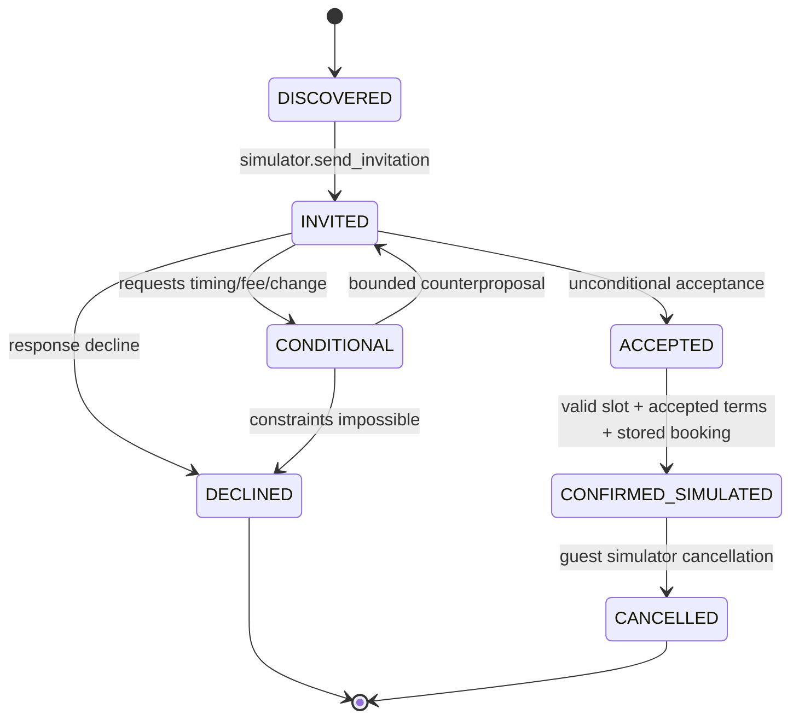
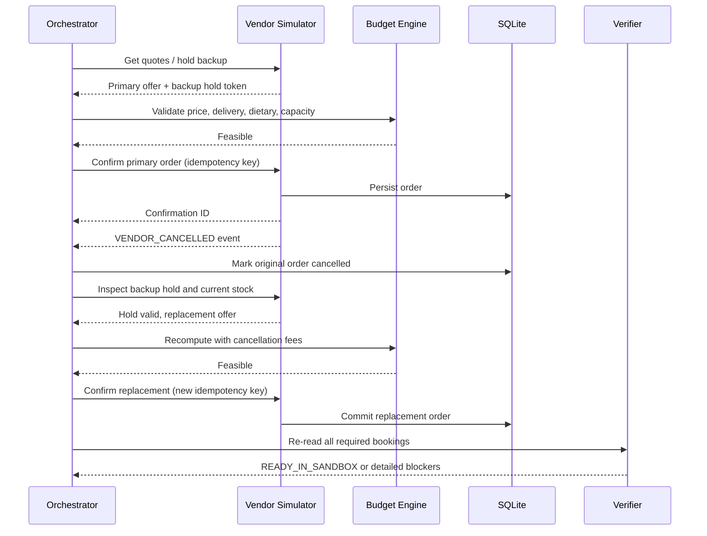

# WORKFLOWS — Normal execution and disruption recovery

## 1. Working example (synthetic event)
**Organizer request:** "Organize an AI/ML community orientation on 12 Nov 2026, 4–7 PM in Mumbai, for 120 students, venue cap 150, max spend ₹25,000. Book two guest mentors (one ML engineering, one startup/AI founder), refreshments including 25 vegetarian-only meals, projector/audio, and plan a reel campaign. Handle cancellation backups."

**Notes:** All candidate personal details are sourced from live Crustdata only when actually returned; below we use `person_A` etc. as placeholders, never claim those names exist. Guest responses and vendor inventory/pricing are fictional/simulated.

### Execution walkthrough
| Time/sequence | Component and action | Persisted result / rationale |
|---|---|---|
| 1 | `parse_request` extracts budget ₹25k, audience 120, venue cap 150, two guests, 4–7 PM, dietary/time constraints | `events.status=PLANNING`, structured validated brief |
| 2 | `plan_event` generates slots 4:15–5:00 and 5:15–6:00, budget allocation and required resources | `event_plan` with hard vs soft goals |
| 3 | `search_guests` invokes REAL Crustdata Person Search/Enrich with ML + AI founder criteria | candidates with canonical identity IDs and evidence; **no inferred availability** |
| 4 | `guest_simulator.send_invitation` for top candidates | synthetic replies: A asks to move to 4:30; B declines; C accepts |
| 5 | `coordinate_guests` checks amended slot 4:30–5:15, honorarium cap and schedule overlap; books A and C in sandbox | `guest_bookings` status `CONFIRMED_SIMULATED` x2 |
| 6 | `get_quotes(food=120, av=1)` returns multiple synthetic offers; optimizer computes all-in cost incl delivery and backup holds | candidate selection and calculation stored |
| 7 | `book_vendor` atomically confirms primary food + AV; `hold_vendor` reserves alternate caterer | sandbox orders + hold token, expiry, contingency amount |
| 8 | `promotion_generator` writes event caption, poster text, reel storyboard | assets `DRAFT_SIMULATED`; no public post |
| 9 | `verifier.verify(event_id)` reads back state and recomputes all constraints | `READY_IN_SANDBOX` if all checks pass |
| 10 | Demo injects `VENDOR_CANCELLED(primary_food_order)` | event becomes `NEEDS_RECOVERY`; order no longer counts as active |
| 11 | Recovery checks backup hold (valid time/capacity/diet), calculates cancellation fee and remaining budget, commits replacement | original marked cancelled; replacement confirmed, same service category |
| 12 | Verifier rereads orders/budget/guest bookings and emits final evidence report | `READY_IN_SANDBOX` restored, recovery trace visible |

### Example allocation (fictional)
| Category | Sandbox cost |
|---|---:|
| 2 mentor honorariums | ₹6,000 |
| 120 refreshments incl delivery | ₹10,000 |
| AV equipment | ₹3,000 |
| Promotion allocation | ₹1,000 |
| Available contingency before cancellation | ₹5,000 |
| Backup caterer replacement cost | ₹10,700 |

If original caterer cancellation incurs a nonrefundable fee, **add it**; don't silently erase previous charges. The replacement can be committed only if total commitments remain within ₹25,000.

## 2. Guest negotiation state machine

- Always preserve conversation history and conditions.
- Negotiation max 3 rounds per guest. If no confirmed feasible agreement, try next candidate.
- `CONFIRMED_SIMULATED` means both accepted conditions and persisted simulated calendar state, not just invitation sent.
- When a guest cancels: find a relevant available alternate, ensure not double-booked, and update agenda.

## 3. Vendor fallback workflow

If held offer expired, request fresh quotes. If no feasible replacement, set `BLOCKED` with evidence, never `READY`.

## 4. Attendance-change workflow
- Event has `expected_attendance=120`, `venue_capacity=150`.
- Incoming simulator registration event updates expected/confirmed count to 145: recompute food demand, AV and activity capacity; use quote modification if deadline allows; reverify.
- A second update reports 175: venue cap violated. System caps registrations/waitlists extra 25 (if organizer policy allows) or returns `BLOCKED_CAPACITY`; **no unsafe overcapacity booking**.
- When turnout decreases to 80, first check vendor quantity-change deadline and cancellation terms; optimize only if changes are feasible and actually confirmed.

## 5. Unexpected tool/API failures
| Failure | Behavior |
|---|---|
| Crustdata timeout | Retry with capped attempts; distinguish `NO_RESULTS` from `API_FAILURE` |
| Crustdata missing person title | Do not invent; possibly enrich; mark role unverified |
| Guest simulator no reply | Persist `AWAITING_SIMULATED_REPLY`; local clock advance/replay scenario; do not busy-wait |
| Two identical guest replies | Deduplicate by inbound `message_id` |
| Booking request times out after commit | Query existing order by idempotency key before retry |
| Backup hold expired | Request re-quote; do not book at stale price |
| Changed price | Revalidate *all-in* cost and budget before commitment |
| Duplicate simultaneous orders | DB unique constraint on idempotency key + transactional guard |
| No replacement | Mark event `BLOCKED`, emit exact unmet resource constraints |

## 6. Final event readiness gates
`READY_IN_SANDBOX` iff all true:
- Correct event brief and hard constraints recorded.
- `confirmed_simulated_guest_count >= guest_count`, no session overlap and roles match requirements.
- Real Crustdata search provenance exists for guest records used.
- Catering/equipment active sandbox orders cover required quantities with valid delivery times, dietary rules and capacity.
- Venue capacity >= admitted attendees.
- `committed_cost + active_hold_liabilities + unrecoverable_fees <= hard_budget` (do not double-count overlapping reservations; define liability rules explicitly).
- No unresolved **critical** issues and no cancelled order counted as active.
- Final verifier independently queries SQLite and attaches proof IDs.

## 7. Two-minute demo choreography
- **0–15s:** submit event brief; show hard constraints.
- **15–40s:** show live Crustdata speaker search + evidence IDs, then synthetic reply negotiation.
- **40–65s:** simulator vendor quotations, chosen bookings, budget ledger.
- **65–95s:** click **Simulate cancellation**; observe automatic fallback and new order confirmation.
- **95–115s:** show readiness verification, audit trace, no over-budget state.
- **115–120s:** succinct value proposition: "event operations executed and recovered, not merely planned".

## 8. Failure-case demo variant
Start with an impossible event: 200 guests, venue max 120, no alternative venue. A good demo should end `BLOCKED_CAPACITY` with explicit corrective options, not falsely marked completed. This shows reliability.
